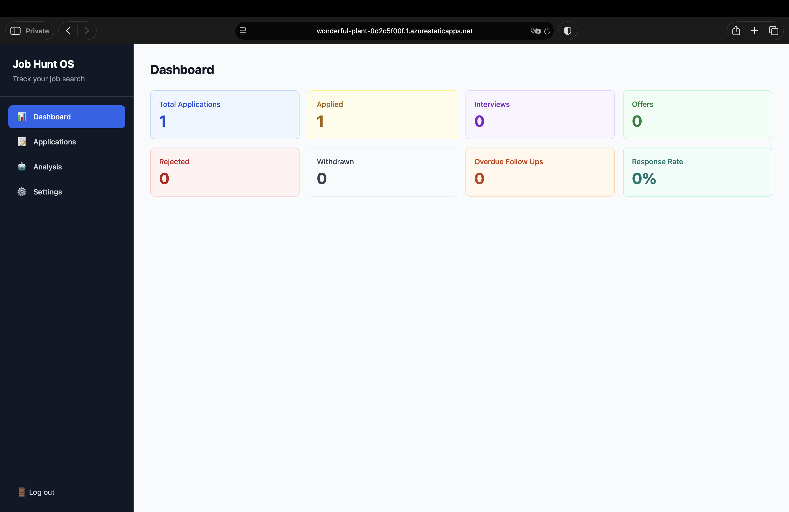
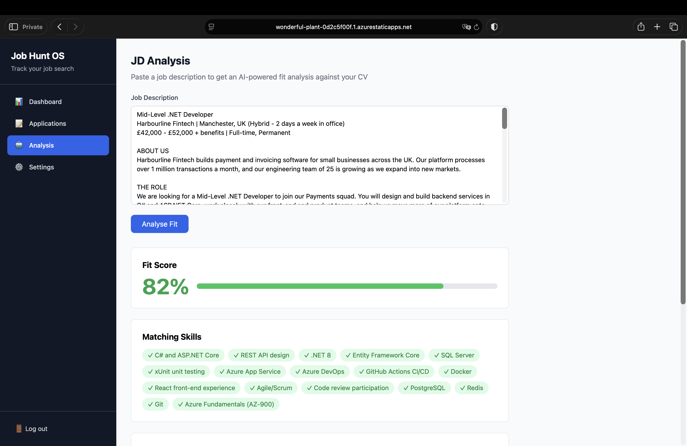

# Job Hunt OS

A full-stack job application tracker with AI-powered fit analysis. Track applications through the pipeline, store your CV, paste a job description, and get a fit score, matching skills, missing skills and tailoring advice from Claude.

**Live demo:** https://wonderful-plant-0d2c5f00f.1.azurestaticapps.net
> Demo project: please use sample data rather than a real CV. See the in-app Terms and Privacy pages.

> The API runs on a scale-to-zero container to keep hosting costs near nothing. The first request after a quiet period can take around 20 to 30 seconds while the server wakes up. The login page starts the warm-up as soon as it loads.




## Features

- **Application tracking:** add, update and soft-delete applications; filter by status (Applied, Interview, Offer, Rejected, Withdrawn)
- **AI fit analysis:** paste a job description and get a 0 to 100 fit score, matching skills, missing skills and recommendations, generated by the Claude API against your stored CV
- **Dashboard:** totals by status, response rate and overdue follow-ups
- **Follow-up dates:** set automatically from the applied date (default 7 days) and surfaced on the dashboard
- **Notes:** per-application notes
- **Accounts:** register and log in with email and password (ASP.NET Core Identity + JWT). Every user only ever sees their own data.
- **Cost protection:** each user is limited to 3 analyses per day, enforced server-side before any paid call is made

## Tech stack

| Layer | Technology |
|---|---|
| Backend | C#, .NET 8, ASP.NET Core Web API, Entity Framework Core |
| Database | PostgreSQL 16 |
| Auth | ASP.NET Core Identity, JWT bearer tokens |
| AI | Anthropic Claude API (`claude-sonnet-4-6`) |
| Frontend | React, TypeScript, Vite, Tailwind CSS, TanStack Query |
| Testing | xUnit, Moq, FluentAssertions |
| DevOps | Docker, Docker Compose, GitHub Actions |
| Hosting | Azure Container Apps (API), Azure Database for PostgreSQL Flexible Server, Azure Container Registry, Azure Static Web Apps (frontend) |

## Architecture

The backend follows clean architecture. Dependencies only point inwards.

```
API  ───────────►  Application  ───────────►  Domain
 │                      ▲
 └───►  Infrastructure ─┘
```

| Project | Responsibility |
|---|---|
| `JobHuntOS.Domain` | Entities and enums. No dependencies. |
| `JobHuntOS.Application` | Services, DTOs and interfaces (repositories, Claude client, current user). Business rules live here. |
| `JobHuntOS.Infrastructure` | EF Core, repositories, migrations, Identity, Claude HTTP client. |
| `JobHuntOS.API` | Controllers, middleware, JWT setup and dependency injection wiring. |

Request flow: `Controller → Service → Repository → PostgreSQL`. Controllers never touch entities, and repositories never see DTOs.

## Design decisions

- **Interfaces in Application, implementations in Infrastructure.** Business logic can be unit tested with mocks and has no knowledge of EF Core or PostgreSQL.
- **Per-user data isolation.** `UserId` is a foreign key on applications, CVs and analyses. Every repository query filters by it, and the user ID comes from the JWT through an `ICurrentUserService`, never from the request body.
- **404 instead of 403 for other people's data.** A request for another user's record returns "not found", so an attacker cannot learn which IDs exist.
- **Parent ownership checks on notes.** Notes carry no `UserId`. The service verifies the parent application belongs to the caller, and that the note belongs to that application, which closes an IDOR hole.
- **Cost guard before the paid call.** The daily limit check runs before the Claude request, so rejected requests cost nothing. A unit test asserts the Claude client is never called once the limit is reached.
- **Soft delete.** Applications are flagged `IsDeleted` rather than removed.
- **Scale-to-zero API.** Chosen to keep monthly cost near zero. The trade-off is a cold start, reduced by a `/health` warm-up call from the login page and an honest loading message.
- **Static frontend on a CDN, separate from the API.** The page loads instantly even while the API container is asleep, and the two deploy independently. CORS origins come from configuration, not code.
- **JWT in `localStorage`.** Simple for a portfolio app, but readable by any script on the page. An httpOnly cookie is the more secure choice, at the cost of CSRF handling.
- **Secrets never in git.** API keys and the JWT signing key are Azure Container Apps secrets, referenced as environment variables. `.dockerignore` keeps local config out of the image.

## API overview

All endpoints except `/api/auth/*` and `/health` require `Authorization: Bearer <token>`.

| Method | Route | Purpose |
|---|---|---|
| POST | `/api/auth/register` | Create an account, returns a JWT |
| POST | `/api/auth/login` | Log in, returns a JWT |
| GET | `/api/applications` | List applications (optional `?status=`) |
| POST | `/api/applications` | Create an application |
| GET / PUT / DELETE | `/api/applications/{id}` | Read, update, soft-delete |
| GET | `/api/applications/reminders` | Applications with overdue follow-ups |
| GET / POST | `/api/applications/{id}/notes` | List and add notes |
| DELETE | `/api/applications/{id}/notes/{noteId}` | Delete a note |
| GET / POST / DELETE | `/api/cv` | Read, replace, remove your CV |
| POST | `/api/analysis` | Run an AI fit analysis (3 per user per day) |
| GET | `/api/analysis/{applicationId}` | Latest analysis for an application |
| GET | `/api/dashboard/stats` | Dashboard statistics |
| GET | `/health` | Health check, used for warm-up |

## Run it locally

Requires Docker Desktop and Node.js.

```bash
git clone https://github.com/a-elhussein/JobHuntOS.git
cd JobHuntOS

# Secrets for local use (this file is gitignored)
cat > .env << 'EOF'
CLAUDE_API_KEY=your-anthropic-api-key
JWT_KEY=any-long-random-string-at-least-32-characters
EOF

# API and database
docker compose up --build

# Frontend, in a second terminal
cd JobHuntOS.Frontend
npm install
npm run dev
```

Open http://localhost:5173. The API listens on http://localhost:8080 and applies database migrations on startup. Registration requires a password of 8+ characters including a number and a symbol.

## Tests

```bash
dotnet test
```

Unit tests cover the application and analysis services, including the daily limit and ownership of saved analyses.

## CI and deployment

- **CI:** GitHub Actions builds the solution and runs the unit tests on every push and pull request to `main`.
- **Frontend:** deployed to Azure Static Web Apps by a GitHub Actions workflow on every merge to `main`.
- **API:** built as a linux/amd64 image, pushed to Azure Container Registry and rolled out to Azure Container Apps. This step is currently run by hand and is the next candidate for automation.

## Known limitations and roadmap

- API deployment is not yet automated in a pipeline
- Reminders appear as a dashboard count; a dedicated reminders list is not built yet
- Google sign-in is planned but not implemented
- The daily limit resets at midnight UTC, and two simultaneous requests could slip one extra through
- Test coverage focuses on the services; controllers and repositories are untested

## Author

Built by Ahmed Elhussein as a portfolio project. Questions or feedback are welcome through [GitHub](https://github.com/a-elhussein).
